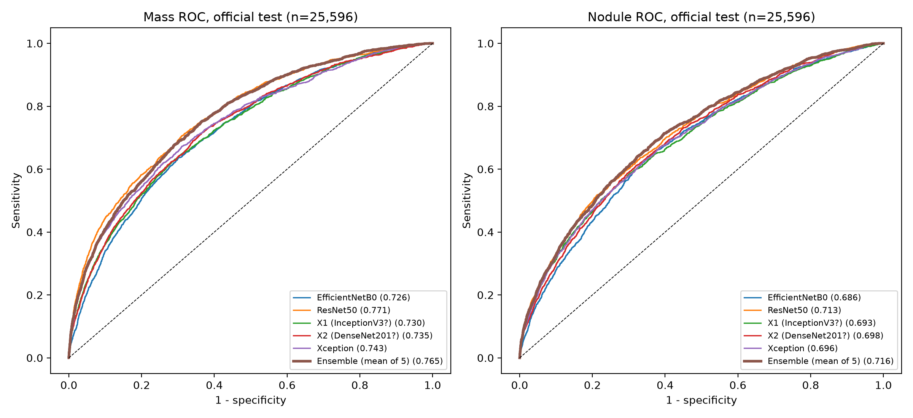
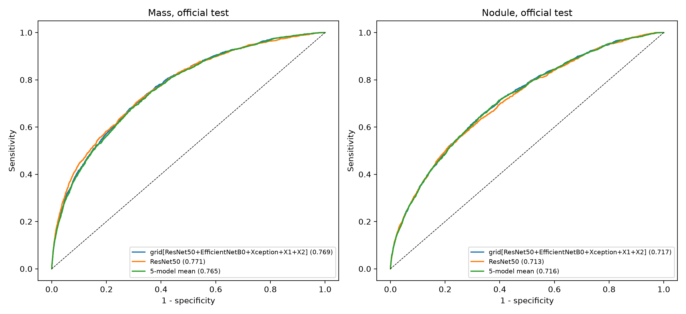

# Detecting Lung Cancer Indicators (Mass, Nodule) on Chest X-Rays with Transfer Learning

Research project by **Aaditya Shah** (2023 - 2024), under mentor **Munib Mesinovic** (PhD student, University of Oxford).

## Problem

Lung cancer is the leading cause of cancer death worldwide, and early detection improves treatment options. Chest X-rays are cheap and widely available, but lung findings are easy to confuse with other diseases. This project asks how well standard ImageNet-pretrained CNNs, adapted with transfer learning, can flag the two ChestX-ray14 findings most closely tied to lung tumours: **Mass** and **Nodule**.

## Dataset

[NIH ChestX-ray14](https://nihcc.app.box.com/v/ChestXray-NIHCC) (Wang et al., 2017): 112,120 frontal chest X-rays from 30,805 patients. Each image has up to 14 pathology labels plus "No Finding". The labels were text-mined from radiology reports. Models were trained on all 15 labels. Evaluation covers all 14 findings, with a focus on Mass and Nodule.

**Split.** The test set is the **official NIH test list**: 25,596 images from 2,797 patients, with 1,748 Mass positives and 1,623 Nodule positives. The validation set (8,536 images) is split from the official train/val list **by patient**. No patient appears in both validation and test. Thresholds and ensemble weights were chosen on validation only.

## Method

| Component | Choice |
|---|---|
| Backbones (ImageNet-pretrained) | EfficientNetB0, ResNet50, DenseNet201, InceptionV3, Xception |
| Head | 15-way sigmoid (one output per label) |
| Input | 224x224 |
| Training | Two stages. Stage 1: backbone frozen, head trained for 2 epochs at learning rate 1e-3. Stage 2: fine-tuning for 6 epochs, learning rate decayed from about 9.3e-5 to 1e-6 |
| Ensemble | Predictions aligned by image ID and label name (checked in code). Main ensemble: simple mean of the five models' probabilities. Weighted means and rank averaging were also evaluated (see below) |
| Metrics | Per-label AUROC with 95% CIs from 1,000 patient-level bootstrap resamples (seed 0); mean AUROC over 14 findings. For Mass and Nodule: sensitivity, specificity, accuracy, F1 and PPV at a threshold chosen on validation (Youden J), and sensitivity at 90% validation specificity |

## Results

Official NIH test split (25,596 images). Mass prevalence 6.8%, Nodule prevalence 6.3%. **Bold** marks the best value in each column.

| Model | Test mean AUROC (14 findings) | Mass AUROC [95% CI] | Nodule AUROC [95% CI] | Mass sensitivity / specificity (val threshold) | Mass sensitivity at 90% val specificity |
|---|---|---|---|---|---|
| ResNet50 | 0.788 | **0.771** [0.750, 0.791] | 0.713 [0.692, 0.734] | 0.816 / 0.552 | 0.561 |
| DenseNet201 | 0.772 | 0.735 [0.714, 0.758] | 0.698 [0.677, 0.719] | 0.752 / 0.586 | 0.504 |
| EfficientNetB0 | 0.771 | 0.726 [0.703, 0.747] | 0.686 [0.664, 0.707] | 0.755 / 0.558 | 0.490 |
| Xception | 0.770 | 0.743 [0.720, 0.766] | 0.696 [0.674, 0.716] | 0.742 / 0.604 | 0.518 |
| InceptionV3 | 0.768 | 0.730 [0.705, 0.752] | 0.693 [0.671, 0.715] | 0.612 / 0.725 | 0.486 |
| Ensemble (mean of 5) | **0.793** | 0.765 [0.743, 0.786] | **0.716** [0.695, 0.737] | 0.823 / 0.541 | **0.562** |

Nodule sensitivity at 90% validation specificity ranged from 0.344 (EfficientNetB0) to 0.409 (ensemble).



**Ensemble findings**
- The simple 5-model mean has the best test mean AUROC (0.793 vs 0.788 for ResNet50).
- On Mass and Nodule, it is not significantly different from ResNet50 alone. Paired bootstrap difference, ensemble minus ResNet50: Mass -0.006 [-0.014, 0.002], Nodule +0.003 [-0.004, 0.009].
- 111 ensemble configurations were compared on validation. They covered all 31 model subsets, with simple means, weights proportional to validation AUROC, a weight grid search (step 0.1) and rank averaging. The validation-selected configuration reached test mean AUROC 0.794, against 0.793 for the simple mean. Compared with ResNet50, its mean AUROC difference was +0.006 [0.004, 0.008]. Its Mass (-0.002 [-0.009, 0.005]) and Nodule (+0.004 [-0.002, 0.010]) differences were not significant. Because many configurations were compared on one validation set, the simple mean is reported as the main ensemble.



**Takeaways**
- ResNet50 is the strongest single model. It has the best mean AUROC (0.788), the best Mass AUROC (0.771) and the best single-model Nodule AUROC (0.713).
- Mass is detected better than Nodule by every model.
- At thresholds chosen on validation, Mass PPV was only about 0.11 to 0.14 because the label is rare. Most flagged images would be false positives.

**Comparison with published work.** These numbers are not directly comparable. Both papers below used random 70/10/20 splits, not the official NIH test list.

| Source | Mass AUROC | Nodule AUROC | Mean AUROC |
|---|---|---|---|
| Wang et al. 2017, CVPR, ResNet-50 (Table 3, 8 labels) | 0.5609 | 0.7164 | 0.696 (8 labels) |
| Wang et al. 2017, as reported in CheXNet (Table 2, 14 labels) | 0.706 | 0.671 | 0.738 (14 labels) |
| CheXNet, Rajpurkar et al. 2017, DenseNet-121 (Table 2) | 0.8676 | 0.7802 | 0.841 (14 labels) |
| This work, 5-model mean | 0.765 | 0.716 | 0.793 (14 labels) |

Sources: [Wang et al. 2017](https://openaccess.thecvf.com/content_cvpr_2017/papers/Wang_ChestX-ray8_Hospital-Scale_Chest_CVPR_2017_paper.pdf), [Rajpurkar et al. 2017](https://arxiv.org/abs/1711.05225).

Result files: [per-label AUROC](results/metrics_all.csv), [Mass and Nodule operating points](results/mass_nodule_summary.csv), [ensemble search](results/ensemble_search.csv).

## Limitations

- **Undertrained.** Every model's best validation AUROC came at its final epoch, so longer training would probably help.
- **Validation/test gap.** Validation mean AUROC was about 0.024 to 0.033 higher than test for every model (for example, ResNet50: 0.812 validation vs 0.788 test over 14 findings).
- **Threshold shift.** Thresholds set for 90% specificity on validation gave only about 80 to 87% specificity on test, so validation-chosen operating points do not transfer exactly.
- **Low PPV.** Mass PPV at the validation Youden threshold was about 0.11 to 0.14.
- **Single run per model** at 224x224, with one seed.
- **Labels are a proxy.** Mass and Nodule are text-mined radiology findings, not confirmed cancer diagnoses, and ChestX-ray14 labels are known to be noisy.

## Code

Training code is in `src`.

Set `DATA_DIR` to the NIH release directory (default `data/nih`) and `OUTPUT_DIR` to the directory for TFRecords, checkpoints, and new prediction files (default `data/output`). Both names work as environment variables and as notebook variables.

- [`notebooks/00_preprocess.ipynb`](notebooks/00_preprocess.ipynb) builds the patient split and TFRecords from `Data_Entry_2017.csv`, `train_val_list.txt`, `test_list.txt`, and the image folders.
- [`notebooks/01_train.ipynb`](notebooks/01_train.ipynb) trains one backbone. Set `BACKBONE` to EfficientNetB0, ResNet50, DenseNet201, InceptionV3, or Xception. Keep `SEED = 42`, `STAGE1_EPOCHS = 2`, `EPOCHS = 6`, and `WEIGHTS = "imagenet"`.
- [`notebooks/01_train_InceptionV3.ipynb`](notebooks/01_train_InceptionV3.ipynb), [`notebooks/01_train_ResNet50.ipynb`](notebooks/01_train_ResNet50.ipynb), and [`notebooks/01_train_Xception.ipynb`](notebooks/01_train_Xception.ipynb) are the same procedure with `BACKBONE` already set. The Xception notebook trains in float32 with gradient clip norm 1 and XLA off. The other backbones use mixed precision when a GPU is visible.
- [`notebooks/01_train_DenseNet201.ipynb`](notebooks/01_train_DenseNet201.ipynb) trains one frozen DenseNet201 on a random split. The tables above come from the five-backbone runs, not from that notebook.
- [`notebooks/02_evaluate.ipynb`](notebooks/02_evaluate.ipynb) averages saved predictions and writes ROC curves.

Each epoch writes a checkpoint. Starting the same backbone again, with the same output directory, continues from the latest epoch. New epochs stop around 4.5 hours so the prediction files can still be written. If a backbone runs out of memory, set `BATCH_SIZE = 8` and start that backbone again. Do not change the batch size in the middle of a resumed run. If the log says early stopping on validation AUROC, training is finished.

The scripts below recompute the tables from the saved prediction CSVs.

### Evaluation scripts

[`scripts/eval.py`](scripts/eval.py) writes the per-label metrics, the Mass and Nodule operating-point table, and `results/figures/roc_mass_nodule.png`.

[`scripts/search.py`](scripts/search.py) writes the ensemble search table and `results/figures/roc_best_ensemble.png`.

Both scripts read the NIH label file `Data_Entry_2017.csv` (112,120 rows) and one test prediction CSV plus one validation prediction CSV per model. `Data_Entry_2017.csv` is not in this repository. Download it with the NIH ChestX-ray14 release linked above. The prediction CSVs from the reported runs are in the repository:

| Model | Predictions |
|---|---|
| EfficientNetB0 | `data/efficientnetb0/` |
| DenseNet201 | `data/densenet201/` |
| InceptionV3 | `data/inceptionv3/` |
| Xception | `data/xception/` |
| ResNet50 | `data/resnet50/` |

Each folder contains `preds_test_<Model>.csv` (25,596 rows), `preds_val_<Model>.csv` (8,536 rows), and `history_<Model>.csv`.

```bash
pip install -r requirements.txt
python scripts/eval.py --labels /path/to/Data_Entry_2017.csv
python scripts/search.py --labels /path/to/Data_Entry_2017.csv
```

`--out-dir` defaults to `results`. Pass `--pred-root` if the five model folders are not under `data/`. `python scripts/eval.py --help` and `python scripts/search.py --help` list every flag.

## Acknowledgements

Thanks to **Munib Mesinovic** (PhD student, University of Oxford) for mentoring this project.
